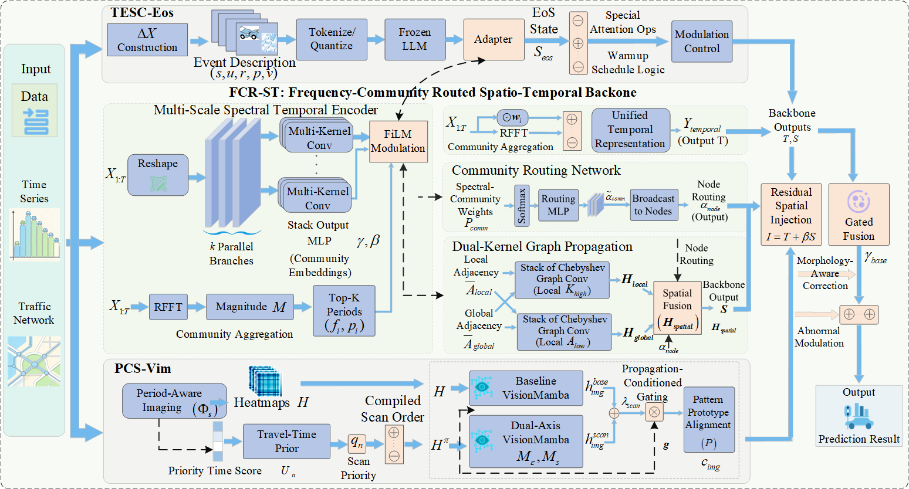

<div align="center">

# Community-Conditioned Spectral Routing for Traffic Prediction under Changing Traffic Conditions

[](https://pytorch.org/)
[](https://opensource.org/licenses/MIT)

</div>

## 💡 Overview

Urban traffic prediction requires modeling temporal frequency patterns, road-network topology, and changing traffic states. However, frequency-agnostic spatial operators may apply similar propagation patterns to road communities with different temporal characteristics, while fixed sequence orderings may fail to reflect the topology of non-grid sensor networks. Traffic-regime transitions further increase the difficulty of stable prediction.

This repository contains the implementation and experimental resources for **Community-Conditioned Spectral Routing for Traffic Prediction under Changing Traffic Conditions**. The proposed framework is centered on **community-conditioned spectral routing**: it uses community-level spectral descriptors to adaptively balance local and global graph propagation. Two complementary components provide topology-informed morphology encoding and evidence-driven traffic-state control.

Experiments on six real-world traffic datasets show improvements over the compared baselines. In particular, the proposed method reduces MAE by **23.9% on PeMS-BAY at the 15-minute prediction horizon** (MAE 0.921).

<p align="center">
  
  <br>
  <em>Overall architecture of the proposed traffic prediction framework.</em>
</p>

## 🚀 Key Modules & Design

The framework contains three complementary components. Its central mechanism is FCR-ST; PCS-ViM and TSC provide additional topology and traffic-state information.

* **1. FCR-ST (Frequency-Community Routed Spatio-Temporal Backbone)** 🎶
  * **Role:** Core spectral-spatial prediction backbone.
  * **Mechanism:** It constructs road communities through spectral clustering on the normalized graph Laplacian, applies RFFT to traffic observations, and aggregates spectral magnitudes within each community. Community-level spectral descriptors generate routing weights that balance local graph propagation for short-range dependencies and global propagation for broader interactions. The graph filters are implemented with Chebyshev polynomial approximation.

* **2. PCS-ViM (Propagation-Compiled Scanning VisionMamba)** 👁️
  * **Role:** Topology-informed morphology encoder.
  * **Mechanism:** It derives node priorities from community potential and average shortest-path costs, then reorders nodes to form a topology-informed scan sequence. Dual-axis VisionMamba encoders model temporal and reordered spatial patterns. A non-reordered branch, learnable morphology prototypes, and a propagation-aware gate are used to preserve spatial cues and inject the resulting morphology correction. The priority-based ordering is a scan heuristic; it does not guarantee that every directed road edge is traversed consistently.

* **3. TSC (Traffic State Controller)** 🧠
  * **Role:** Evidence-driven state control for changing traffic conditions.
  * **Mechanism:** It constructs a five-dimensional evidence vector describing shock, trend, recovery, volatility, and magnitude. A lightweight MLP maps this vector to a latent state, which is anchored by a learnable prototype bank. A warmup gate then uses the state to modulate community-routing logits and the strength of feature-level residual correction. **TSC is an MLP-based controller; the proposed framework does not require an LLM branch.**

## ⚙️ Algorithm & Execution Flow

The overall training and inference process follows the methodology and algorithm in the paper:

```text
Algorithm: Training and Inference Procedure
----------------------------------------------------------------------------
Input: Training data (X, Y), road graph A, epochs E, warmup schedule λ(t).
Output: Trained parameters Θ and traffic predictions Y_hat.

Offline preprocessing:
  1. Compute the normalized graph Laplacian and spectral community assignments.
  2. Compute average shortest-path costs for topology-informed node priorities.
  3. Initialize model parameters.

For each training epoch and mini-batch:
  [Stage 1: FCR-ST]
    - Apply RFFT and aggregate community-specific spectral descriptors.
    - Extract period-aware temporal features and apply community affine modulation.
    - Generate community routing weights from spectral descriptors.
    - Balance local and global Chebyshev graph-filter outputs.

  [Stage 2: PCS-ViM]
    - Construct pseudo-image features and compute topology-informed node priorities.
    - Reorder nodes and apply dual-axis VisionMamba encoding.
    - Fuse reordered and original-order features.
    - Use morphology prototypes and a topology-aware gate to obtain an image correction.

  [Stage 3: TSC]
    - Extract the five-dimensional traffic-state evidence vector.
    - Encode the evidence with an MLP and perform prototype-based state anchoring.
    - Modulate routing logits and feature-correction strength through the warmup gate.

  [Prediction and optimization]
    - Perform state-conditioned local/global spatial routing.
    - Apply the state-guided feature correction before the prediction head.
    - Add the PCS-ViM morphology correction to obtain the final prediction.
    - Optimize the prediction, spectral-consistency, and regularization losses.

Inference:
  - Set the warmup gate λ(t) to 1 and disable gradients.
----------------------------------------------------------------------------
```

The training objective combines an MAE-plus-Huber prediction loss, a spectral-consistency loss, and regularization for routing separability and graph-kernel orthogonality.

## 📊 Datasets & Main Results

The framework is evaluated on six real-world traffic datasets. All datasets are sampled at 5-minute intervals.

| Dataset | Nodes | Edges | Time Steps | Time Range |
|---|---:|---:|---:|---|
| PeMS03 | 358 | 547 | 26,208 | 2018-09-01 to 2018-11-30 |
| PeMS04 | 307 | 340 | 16,992 | 2018-01-01 to 2018-02-28 |
| PeMS07 | 883 | 866 | 28,224 | 2017-05-01 to 2017-08-31 |
| PeMS08 | 170 | 295 | 17,856 | 2016-07-01 to 2016-08-31 |
| METR-LA | 207 | 1,515 | 34,272 | 2012-03 to 2012-06 |
| PeMS-BAY | 325 | 2,369 | 52,116 | 2017-01 to 2017-06 |

The following values are reported in the paper's performance comparison tables:

| Dataset | Proposed MAE | Reported MAE improvement |
|---|---:|---:|
| PeMS03 | 12.08 | 15.82% |
| PeMS04 | 15.81 | 12.60% |
| PeMS07 | 16.36 | 14.52% |
| PeMS08 | 12.14 | 8.72% |
| PeMS-BAY (15 min) | 0.921 | **23.9%** |
| METR-LA (60 min) | 2.84 | — |

For METR-LA at the 60-minute horizon, the paper reports an MAE of 2.84, compared with 3.34 for STAEformer and 3.31 for ST-MambaSync. The paper evaluates performance using MAE, RMSE, and MAPE; lower values indicate better performance.

## 🔬 Experimental Settings

The experimental settings reported in the paper are:

- **Framework:** PyTorch.
- **Hardware:** NVIDIA RTX 5090 GPU (32 GB), Intel Xeon Platinum 8470Q CPU (25 vCPUs), and 90 GB RAM.
- **Dataset split:** Chronological training/validation/test split of 7:2:1.
- **Optimization:** Learning rate 0.0001 and batch size 32.
- **Evaluation metrics:** Mean Absolute Error (MAE), Root Mean Square Error (RMSE), and Mean Absolute Percentage Error (MAPE).

## 📉 Ablation & Traffic-State Analysis

The paper evaluates the contribution of each component on PeMS08:

- **w/o FCR-ST:** Replaces dynamic frequency-community routing with static graph convolution. Prediction errors increase, particularly at the 120-minute horizon.
- **w/o PCS-ViM:** Replaces topology-informed node ordering and visual sequence encoding with standard Euclidean raster scanning. RMSE increases, supporting the use of topology-informed scanning.
- **w/o TSC:** Removes the MLP-based state controller and its state-guided modulation of routing and residual correction. Prediction errors increase across the evaluated horizons.

The paper also analyzes TSC in a selected anomaly window. Compared with the variant without TSC, the full model achieves a **3.62% reduction in window-level MAE**, a positive MAE advantage over **65.70% of sliding steps**, and a **4.16% MAE reduction in the peak-transition region**.

## ⚡ Complexity & Efficiency

The paper analyzes the forward-pass complexity under a fixed graph structure. Let $B$ be the batch size, $T$ the input sequence length, $N$ the number of nodes, $D_{in}$ the input feature dimension, and $d$ the hidden dimension.

1. **FCR-ST:** RFFT costs approximately $\mathcal{O}(BND_{in}T\log T)$; Chebyshev graph filtering costs $\mathcal{O}(BTK_g|\mathcal{E}|d)$, where $K_g$ is the polynomial order.
2. **PCS-ViM:** Dual-axis state-space encoding costs $\mathcal{O}(BTNd)$, and morphology-prototype matching costs $\mathcal{O}(BTNK_md)$, where $K_m$ is the number of morphology prototypes.
3. **TSC:** The MLP-based controller costs approximately $\mathcal{O}(Bd(D_v+K_s+C)+BTNd)$, where $D_v=5$, $K_s$ is the number of state prototypes, and $C$ is the number of communities.

For sparse graphs with $|\mathcal{E}|=\mathcal{O}(N)$ and fixed feature/prototype dimensions, the dominant scaling is approximately $\mathcal{O}(BNT\log T)$. Offline preprocessing, including spectral clustering and shortest-path computation, is excluded from the per-batch complexity.

## 🛠️ Getting Started

### 1. Clone the repository

The repository contains large dataset and model files managed with Git LFS. Make sure Git LFS is installed before cloning.

```bash
git lfs install
git clone https://github.com/JOJOJISHENGWU/WWW.git
cd WWW
git lfs pull
```

### 2. Repository contents

```text
WWW/
├── DATA/                    # Traffic datasets
├── checkpoints/             # Model checkpoints
├── configs/                 # Dataset/model configurations
├── logs/                    # Training logs
├── models/                  # FCR-ST, PCS-ViM, TSC, and model implementation
├── reproducibility/         # Reproducibility notes and result tables
├── scripts/                 # Training/evaluation scripts
├── train.py                 # Training entry point
└── SCOUT.png                # Framework illustration
```

The current repository snapshot includes the PEMS08 configuration, checkpoint, full training log, and reproducibility/result documentation. The exact runtime dependencies and command-line arguments should be checked against the current source files and scripts. This snapshot does not include a `requirements.txt` or a top-level `eval.py`; therefore, the former README's generic installation and `python eval.py` commands have been removed rather than retained as unverified instructions.

## 🧩 Implementation-to-Paper Mapping

The main implementation files correspond to the three components described in the paper:

- **`models/FCR_ST.py`** — community-level spectral descriptors and local/global graph-propagation routing.
- **`models/PCS_ViM.py`** — topology-informed node ordering, dual-axis VisionMamba encoding, and morphology correction.
- **`models/TSC.py`** — five-dimensional traffic evidence, MLP state induction, prototype anchoring, and warmup-gated modulation.

Additional resources:

- **`configs/`** — dataset-specific configuration files, including `configs/pems08.yaml`.
- **`checkpoints/pems08_best.pth`** — released PEMS08 checkpoint.
- **`logs/pems08_train_full.log`** — PEMS08 training log.
- **`reproducibility/REPRODUCIBILITY.md`** and **`reproducibility/RESULTS_TABLE.md`** — reproducibility notes and reported results.


